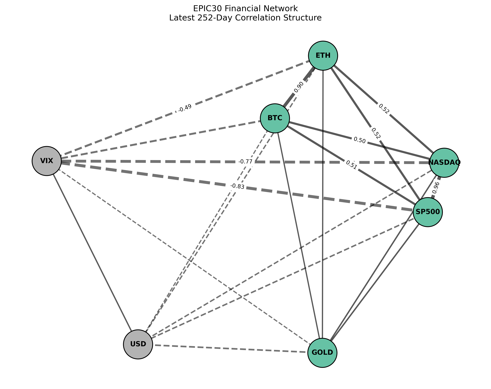
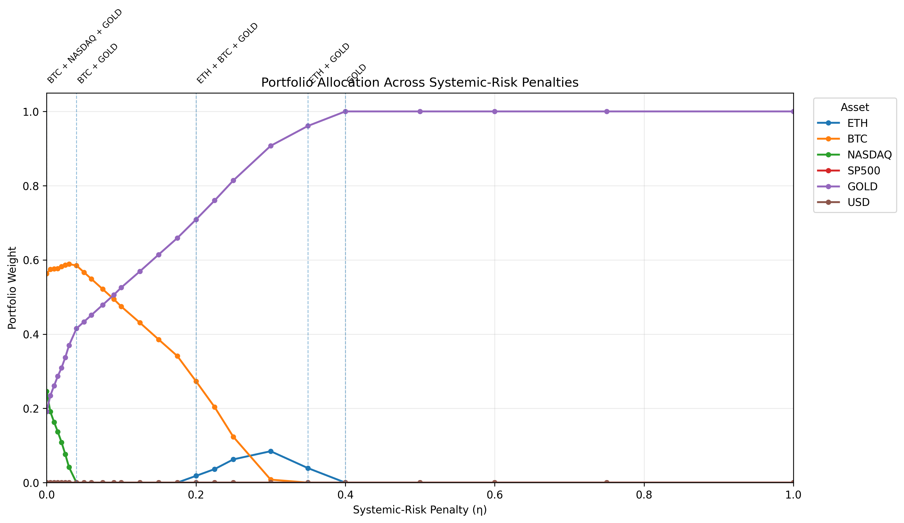

# EPIC30 — Financial Risk & Quantum Optimization

*An independent research project on network-derived risk, constrained portfolio selection, and classical–quantum optimization.*

**Study status (October 2026):** Data preparation, factor diagnostics, dependence-network and spectral analysis, a network-derived risk proxy, continuous and exact discrete optimization, QUBO formulation and penalty calibration, QUBO-to-Ising mapping and full energy-equivalence validation, classical simulated annealing, QAOA experiments at $p=1$ and $p=2$, and consolidated solver comparison are complete. MIP/MIQP and VQE remain optional benchmark extensions.

**Scope:** This is a small, reproducible methodological experiment. It does not establish out-of-sample investment performance, causal financial contagion, or quantum advantage.

## 1. Background and Motivation

While working in telecommunications, healthcare, and automotive projects, I repeatedly faced a similar question: how can I narrow down many possible solutions and find one that is suitable for a problem under specific constraints?

Not every problem I worked on was NP-hard, and I did not always need to choose one solution from millions of combinations. However, working with AI since 2016 made me aware of situations in which predictions or automated analysis alone do not determine the best decision. Even when AI provides useful information, a separate optimization step may still be necessary to identify a feasible solution and evaluate trade-offs.

I see this process—finding an optimal solution, or narrowing a large set of possibilities to a smaller set of suitable solutions—as an optimization problem. It becomes especially relevant when constraints, uncertainty, and changing external conditions are involved. This led me to explore classical, quantum, and hybrid optimization approaches, not as interchangeable tools, but as methods whose usefulness depends on the structure and complexity of the problem.

I chose portfolio optimization as a starting point because it provides a clear risk–return objective, measurable constraints, and an opportunity to examine how interconnected risks may change an otherwise conventional decision.

**Current research question**

**How does a network-derived systemic-risk signal change portfolio allocation and constrained asset selection, and how do exact, classical QUBO, and QAOA methods compare when solving the same discrete portfolio problem?**

The aim of this first study is to build and validate an end-to-end experimental framework, not to claim quantum advantage from a six-variable portfolio instance.

## 2. Study Design and Data

### 2.1 Asset selection and data

The project started with Ethereum (ETH). I then expanded the universe to compare different types of market exposure and observe how their relationships change over time.

| Role | Instruments / modeled exposures |
|---|---|
| Portfolio candidate universe (6) | ETH, BTC, NASDAQ, S&P 500, GOLD, USD |
| Non-investable external risk indicator (1) | VIX |

The six candidates represent market exposures rather than six directly tradable securities. Index and USD exposures should be clearly defined before interpreting the results as a tradable strategy. VIX participates in network-risk estimation but receives no portfolio weight.

NASDAQ and S&P 500 have overlapping exposures. I retained both in the candidate universe and examined their relationship rather than assuming that they contribute independent information. GOLD provides a contrasting exposure, while USD provides a currency-related exposure.

The current aligned historical-return dataset contains 1,660 daily observations, from 03.01.2020 through 12.08.2026, assembled using historical market data retrieved through yfinance. The analysis uses aligned daily log returns. The dataset is an in-sample research snapshot, not a live trading feed.

Data collection and preprocessing are implemented in `src/data_loader.py`. Results are intended for methodological evaluation rather than direct investment applications.

Exploratory static and 252-observation rolling factor models use ETH as the response variable and market exposures as explanatory variables. Their purpose is to examine changing associations and diagnose overlapping predictors; their coefficients are not used as causal effects or as direct inputs to the portfolio optimizer.

### 2.2 Dependence network, spectral analysis, and systemic-risk proxy

The network stage contains seven nodes: ETH, BTC, NASDAQ, S&P 500, GOLD, USD, and VIX. Covariance and correlation are calculated using rolling windows of 252 aligned daily-return observations with a one-observation step. The latest network snapshot ends on 12.08.2026.

The analyses use related but distinct graph constructions:

- **Signed network visualization:** all 21 pairwise relationships among seven nodes are retained. Edge signs distinguish positive and negative correlations; edge strength reflects absolute correlation. Correlation distance is defined as $d_{ij}=\sqrt{2(1-\rho_{ij})}$.
- **Community and spectral analysis:** a positive-correlation similarity graph excludes negative links. For the latest snapshot, its unnormalized graph Laplacian, $L=D-W$, has two connected components: `{ETH, BTC, NASDAQ, SP500, GOLD}` and `{USD, VIX}`. Consequently, the full graph has two zero Laplacian eigenvalues and zero global algebraic connectivity; component-level spectral diagnostics are analyzed separately.
- **Systemic-risk proxy:** a different, non-negative dependence matrix uses $W_{ij}=|\rho_{ij}|$ (zero diagonal), normalized as $T=W/\rho(W)$, where $\rho(W)$ is the spectral radius. An illustrative unit shock is initiated at each node in turn, and propagated with $\alpha=0.5$ over five steps. The accumulated response produces a relative **dependence-based risk score**, not an empirically identified causal transmission coefficient.

Scores from the seven-node model are restricted to the six portfolio candidates and scaled by the maximum score among those six candidates:

$$
\tilde{s}_i = \frac{s_i}{\max_{j \in \mathcal{I}} s_j}
$$

where $\mathcal{I}$ is the investable candidate set. VIX influences the network calculation but is not selected as an asset.

Graph and spectral analyses provide **complementary descriptions** of historical dependence. In particular, correlation strength and illustrative shock propagation should not be interpreted as verified financial contagion.

*Figure 1. Latest seven-node signed correlation network based on the 252-observation window ending on 12.08.2026. Community and spectral results use the **separate** positive-correlation similarity graph.*

## 3. Continuous Portfolio Optimization

The continuous model establishes an allocation baseline and shows how the risk–return trade-off changes when the network-risk term is introduced. It does **not** impose an exact three-asset cardinality constraint.

The estimation horizons differ deliberately:

- **Long-run expected-return estimate, $\mu_{\mathrm{full}}$:** annualized mean historical log returns from the complete 1,660-observation sample.
- **Recent covariance, $\Sigma_{252}$:** covariance from the latest 252 daily observations, annualized by a factor of 252.
- **Recent dependence-based risk, $\tilde{s}_{252}$:** scores derived from the latest 252-observation network and scaled as described in Section 2.2.

Using the full sample for the expected-return estimate reduces reliance on a single recent return window, while the covariance and network-risk terms reflect more recent market conditions. This is a modeling choice, not evidence of improved forecasting; alternative estimation windows remain to be tested. 

### 3.1 Objectives and constraints

The standard objective is:

$$
\min_{w} F_0(w) = \frac{1}{2} w^\top \Sigma_{252} w - \frac{1}{2} \mu_{\mathrm{full}}^\top w
$$

The systemic-risk-adjusted objective adds a third term:

$$
\min_{w} F_\eta(w) = \frac{1}{2} w^\top \Sigma_{252} w - \frac{1}{2} \mu_{\mathrm{full}}^\top w + \eta \tilde{s}_{252}^\top w
$$

Both are solved with the same long-only, fully invested constraints:

$$
 w_i\geq0\quad\forall i,\qquad \sum_{i=1}^{6}w_i=1.
$$

There is no maximum-weight constraint or cardinality restriction in this continuous baseline. SLSQP is used for the constrained numerical optimization. Reported active assets use a weight threshold of **$10^{-4}$**; smaller numerical weights are treated as zero. The coefficients `0.5`, `0.5`, and $\eta$ are objective weights, not percentages of actual risk, return, and network-risk contributions.

### 3.2 Sensitivity to the systemic-risk coefficient

I evaluated **26 values of $\eta$**, from 0 through 1, to identify changes in portfolio composition and the modeled return–variance–network-risk trade-off. The discrete benchmark uses **$\eta=0.15$** as a representative adjusted scenario, not as a mathematically or economically optimal coefficient.

Selected results from the continuous-allocation sweep are:

| $\eta$ | Active assets | Portfolio weights (rounded) |
|---:|---|---|
| **0.00 (standard)** | BTC, NASDAQ, GOLD | BTC 0.5631 · NASDAQ 0.2458 · GOLD 0.1911 |
| 0.03 | BTC, NASDAQ, GOLD | BTC 0.5887 · NASDAQ 0.0415 · GOLD 0.3698 |
| 0.04 | BTC, GOLD | BTC 0.5849 · GOLD 0.4151 |
| **0.15** | **BTC, GOLD** | **BTC 0.3856 · GOLD 0.6144** |
| 0.20 | ETH, BTC, GOLD | ETH 0.0182 · BTC 0.2732 · GOLD 0.7086 |
| 0.35 | ETH, GOLD | ETH 0.0390 · GOLD 0.9610 |
| 0.40 | GOLD | GOLD 1.0000 |

The complete sweep is stored in `data/classical_optimization/systemic_risk_sensitivity.csv`. These results are based on the current historical sample and do not demonstrate future or out-of-sample performance. Objective values calculated at different $\eta$ values are not directly comparable as performance scores because the objective itself changes.

*Figure 2. Continuous allocation weights across the systemic-risk coefficient sweep. Annotations mark changes in the active asset set.*

## 4. Discrete Selection: Exactly Three Assets Out of Six

The discrete stage deliberately changes the decision space. Instead of optimizing continuous allocation weights, it selects **exactly three** of the six candidates, assigning each selected asset an **equal weight of $1/3$**. The equal-weight discrete solution should not be confused with the optimized weights in Section 3.

Let $x_i \in \lbrace 0,1 \rbrace$ indicate whether candidate $i$ is selected. The cardinality constraint is $\sum_{i=1}^{6}x_i=3$, so $w_i=x_i/3$.

The standard discrete objective is:

$$
F_0(x)=\frac{0.5}{9}x^\top\Sigma_{252}x-\frac{0.5}{3}\mu_{\mathrm{full}}^\top x.
$$

The systemic-risk-adjusted objective is:

$$
F_\eta(x)=F_0(x)+\frac{\eta}{3}\tilde{s}_{252}^\top x,\qquad \eta=0.15.
$$

The feasible space contains $\binom{6}{3}=20$ portfolios. **Exact enumeration of those 20 feasible combinations** establishes the constrained optimum for each objective:

| Scenario | Exact constrained portfolio | Objective value |
|---|---|---:|
| Standard, $\eta=0$ | BTC, NASDAQ, GOLD | -0.08438912 |
| Systemic-risk-adjusted, $\eta=0.15$ | BTC, GOLD, USD | 0.01723316 |

These objective values belong to **different objective functions** and should not be read as evidence that one scenario has better investment performance. The exact sensitivity study changes the optimal equal-weight portfolio from BTC/NASDAQ/GOLD to BTC/GOLD/USD within the tested grid as $\eta$ increases.

### 4.1 QUBO formulation, penalty calibration and Ising mapping

To permit an unrestricted binary optimizer to search all $2^6=64$ states, the cardinality constraint is encoded as a quadratic penalty:

$$
E_\eta(x)=F_\eta(x)+A\left(\sum_{i=1}^{6}x_i-3\right)^2
=x^\top Q_\eta x+C.
$$

The implementation uses a **full symmetric $Q$ matrix**. For $K=3$, the cardinality penalty contributes $-5A$ to each diagonal, $+A$ to each off-diagonal matrix entry, and a constant $C=9A$. A pairwise coefficient exported to a solver that counts each pair only once is therefore **$2Q_{ij}$** for $i<j$.

For a feasible state, the penalty is zero, so QUBO energy equals the corresponding original discrete objective up to floating-point error. Infeasible states have a positive penalty, but it must be sufficiently large to keep them from becoming the global QUBO minimum.

Exact evaluation of all 64 states was used to calibrate $A$ on the tested grid **0.010–0.025**:

| Scenario | First valid value **on the tested grid** | Selected common benchmark value |
|---|---:|---:|
| Standard | 0.016 | **0.022** |
| Systemic-risk-adjusted | 0.022 | **0.022** |

The selected common penalty, **$A=0.022$**, passes the exact ground-state feasibility and constrained-optimum checks for both scenarios in the calibration results. It is a **calibrated instance-specific choice**, not a proof of the smallest mathematically sufficient penalty. With $A=0.022$, the serialized QUBO constant is **$C=0.198$** in both scenarios.

The verified QUBO was mapped to an Ising Hamiltonian using the convention

$$
x_i = \frac{1-z_i}{2}, \qquad z_i \in \lbrace -1,+1 \rbrace
$$

The resulting Hamiltonian has the form

$$
H_\eta = c_\eta I + \sum_i h_i Z_i + \sum_{i \lt j} J_{ij} Z_i Z_j
$$

where $c_\eta$ is the Ising energy offset produced by the
QUBO-to-Ising transformation. It is distinct from the QUBO
penalty constant $C=0.198$. The verified Ising offsets are approximately
$-0.03250916$ for the standard objective and
$0.08018127$ for the systemic-risk-adjusted objective.

Energy equivalence between the QUBO and Ising representations was exhaustively verified over all $2^6=64$ binary states for both objectives. Across the resulting 128 validation cases, the maximum absolute QUBO-Ising energy difference was approximately

$$
8.33\times10^{-17},
$$

consistent with floating-point precision.

The Ising ground states mapped back to the same binary optima as the exact QUBO solutions:

| Objective | Ground state | Selected assets |
|---|---|---|
| Standard | `011010` | BTC, NASDAQ, GOLD |
| Systemic-risk-adjusted | `010011` | BTC, GOLD, USD |

## 5. Solver Benchmark: One Formulation, Two Objectives

The discrete comparison uses the **same six binary variables, data snapshot, and asset ordering** under two objectives: standard ($\eta=0$) and systemic-risk-adjusted ($\eta=0.15$). The benchmark compares **three methods × two objectives**, with QAOA evaluated at $p=1$ and $p=2$. QUBO-based methods use the same calibrated cardinality penalty.

| Method | Role | Standard: $\eta=0$ | Systemic: $\eta=0.15$ | Status |
|---|---|---|---|---|
| Exact enumeration | Evaluate all 20 constrained portfolios to establish ground truth | BTC, NASDAQ, GOLD | BTC, GOLD, USD | Complete |
| Classical QUBO: simulated annealing | Search the 64-state penalized QUBO space | BTC, NASDAQ, GOLD | BTC, GOLD, USD | Complete — single-seed baseline |
| QAOA | Variational search over the same mapped Ising problem | Best observed depth: $p=1$ | Best observed depth: $p=2$ | Complete |

### 5.1 Simulated annealing results

In the initial simulated-annealing run (`num_reads=1000`, `seed=42`), both returned best bitstrings matched their respective exact constrained solutions:

| Recorded SA metric | Standard | Systemic-risk-adjusted |
|---|---:|---:|
| Best bitstring (`ETH, BTC, NASDAQ, SP500, GOLD, USD` order) | `011010` | `010011` |
| Cardinality / feasibility | 3 / feasible | 3 / feasible |
| Best recorded energy | -0.08438912 | 0.01723316 |
| Gap from exact reference | Approximately 0 | Approximately 0 |
| Ground-state occurrences | 575 / 1,000 | 822 / 1,000 |
| Ground-state sampling frequency | 57.5% | 82.2% |

Both simulated-annealing runs recovered their respective exact constrained optima using the same calibrated cardinality penalty ($A=0.022$). The ground-state sampling frequencies were 57.5% for the standard objective and 82.2% for the systemic-risk-adjusted objective. These results were obtained from 1,000 reads per objective using a fixed random seed of 42. The observed frequencies describe this specific experimental configuration and do not establish general solver reliability or relative problem difficulty. The near-zero optimality gaps reflect floating-point precision.

### 5.2 QAOA results

QAOA was evaluated at depths $p=1$ and $p=2$ using a fixed seed of 42 and 1,000 shots per run.

| Metric | Standard $p=1$ | Standard $p=2$ | Systemic $p=1$ | Systemic $p=2$ |
|---|---:|---:|---:|---:|
| Ground-state probability | **1.8%** | 0.5% | 1.2% | **2.0%** |
| Ground-state rank | **18** | 64 | 49 | **12** |
| Feasible probability | **40.2%** | 33.9% | 34.1% | **40.3%** |
| Expectation | **-0.044623** | -0.038131 | 0.070420 | **0.067697** |
| Optimizer evaluations | **30** | 47 | **34** | 58 |

The exact ground state appeared in the sampled distribution for all four QAOA runs, but it was not the most probable state in any run. These results describe the fixed seed=42 experimental configuration and should not be interpreted as evidence of general QAOA reliability. The final solver comparison reports portfolio selection, feasibility, objective value, gap to the exact optimum, and sampling behavior under the tested configurations. Computational cost is not compared because comparable measurements were not collected across methods.

**Benchmark questions:**

1. Does each approximate solver recover the exact constrained ground state in both scenarios?
2. How frequently do the stochastic methods return feasible states and the exact ground state under the tested configuration?
3. How does the network-derived term change the constrained portfolio, holding the candidate universe and constraints fixed?
4. What solution-quality trade-offs are observable for this six-variable instance, without extrapolating to quantum advantage or large-scale performance?

## 6. Limitations and Optional Extensions

The candidate universe is small enough to allow exact enumeration of all feasible portfolios. The risk signal is constructed from historical correlation and illustrative propagation; it is **not** an identified causal contagion model. Results depend on asset proxies, data alignment, estimation horizons, network construction, coefficient scaling, the selected $\eta$, and the discrete equal-weight assumption. These results are **in-sample illustrations**, not a forward-looking investment test.

The continuous and discrete problems have different feasible sets. Their portfolio weights and optimal objective values should not be compared as though they solve identical tasks. 
Likewise, SA sampling frequencies and QAOA shot probabilities are not directly comparable as computational-efficiency measures.

**Possible benchmark extensions within this same research question:**

- **MIP/MIQP:** an additional classical mathematical-optimization benchmark of the same discrete objective and constraints, using a formulation appropriate to the quadratic objective.
- **VQE:** another variational quantum benchmark using the same verified Ising Hamiltonian. Its continuous circuit parameters do not make the underlying portfolio-selection problem continuous.
- **Robustness checks:** multiple stochastic seeds, penalty sensitivity, alternative estimation windows, and larger instances when justified by the comparison.

These are extensions of the present solver comparison, **not** separate next-stage research questions.

## 7. Open Research Questions

**Umbrella Research Question** 

**How can network-derived risk signals be integrated into constrained decision problems under external shocks, and how do classical, quantum, and hybrid optimization methods perform as these problems become larger and more complex?** 

The current portfolio experiment is a first test case. The broader questions I want to examine are: 

1. **Risk and uncertainty in interconnected systems:** How can external shocks, uncertainty, and interdependencies be modeled in interconnected systems, and how do different representations affect downstream decisions?
2. **Decision-making across domains:** How can these risk and uncertainty representations be integrated into constrained decision problems across domains such as finance, supply chains, and resource allocation? 
3. **Optimization methods and scaling:** As problem size, constraints, and uncertainty increase, how do exact, classical, quantum, and hybrid optimization approaches compare in feasibility, solution quality, robustness, and computational cost? 

These questions concern **modeling assumptions, generalization, and methodological limits**, rather than merely running another algorithm on the existing formulation.

## 8. Reproducibility

The repository separates data preparation, factor and network analysis, continuous and discrete optimization, QUBO construction, and solver execution. Results should be traceable to a common data snapshot and explicit configuration. The primary implementation and result locations are:

| Stage | Implementation | Outputs |
|---|---|---|
| Data preparation | `src/data_loader.py` | `data/market_returns.csv` |
| Dependence and network | `src/rolling_dependence.py`, `src/financial_network.py` | `data/rolling_dependence/`, `data/financial_network/` |
| Community, spectral, risk | `src/community_detection.py`, `src/spectral_analysis.py`, `src/systemic_risk.py` | `data/community_detection/`, `data/spectral_analysis/`, `data/systemic_risk/` |
| Continuous optimization | `src/classical_optimization.py` | `data/classical_optimization/` |
| Exact discrete optimization | `src/exact_discrete_optimization.py` | `data/exact_discrete_optimization/` |
| QUBO formulation | `src/qubo_formulation.py` | `data/qubo/` |
| Classical QUBO solver | `src/classical_qubo_solver.py` | `data/classical_qubo/` |
| Ising mapping | `src/ising_mapping.py` | `data/ising/` |
| QAOA | `src/qaoa_solver.py` | `data/qaoa/` |
| Solver comparison | `src/solver_comparison.py` | `data/comparison/` |

**QUBO consistency:** The QUBO formulation and classical simulated-annealing benchmark use the same calibrated cardinality penalty ($A=0.022$) and the same stored QUBO matrices. The corresponding QUBO constant is **$C=0.198$** for both objectives.

